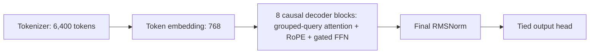
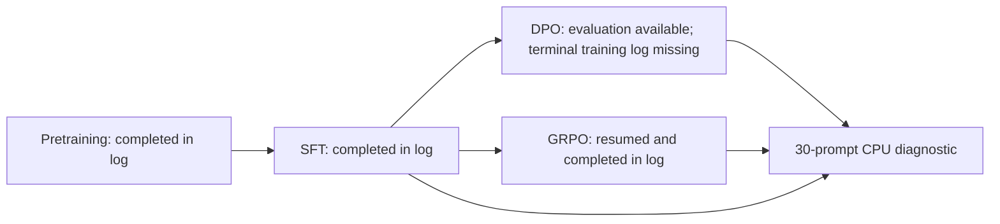
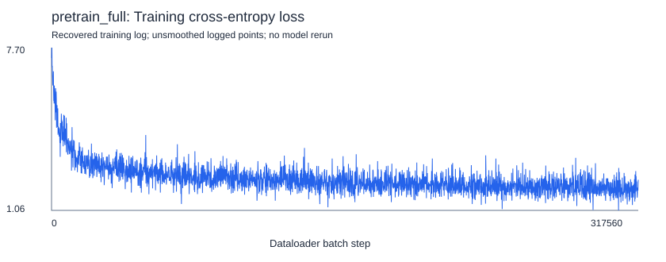
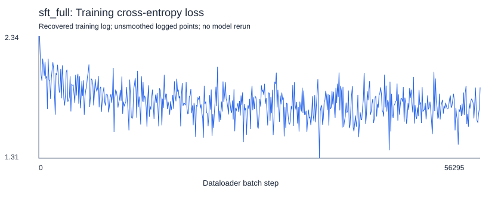
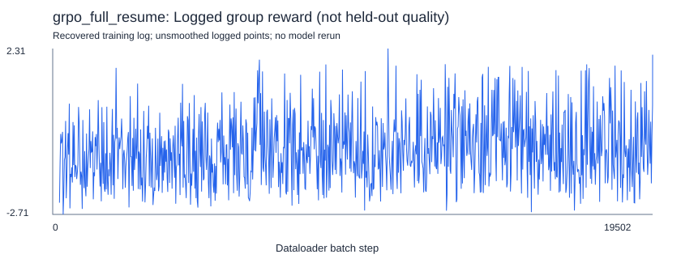

# MiniMind: End-to-End LLM Training & Post-Training

<!-- Portfolio preparation: replaces the upstream root README; originals retained in docs/upstream/. -->

An evidence-backed implementation study of a 64M-class language model spanning **Pretraining → SFT → DPO / GRPO**. The project brings together model architecture, training configurations, resumed reinforcement learning, training curves, and a reproducible diagnostic evaluation protocol.

**Verified outcome:** full pretraining, SFT, and resumed GRPO logs reach their final batch steps. DPO source, a weight inventory entry, and inference reports are recovered, but its complete training log is missing. The custom benchmark reveals substantial generation errors and does not establish strong general-purpose quality or a preference-accuracy improvement.

## Architecture

The dense configuration used in the recovered launch scripts has **768 hidden dimensions**, **8 decoder layers**, **8 query heads / 4 key-value heads**, a **6,400-token vocabulary**, RoPE, RMSNorm and a gated SiLU feed-forward block. Input embeddings and output projection share weights. Logs report **63.91M total parameters** and **63.912M trainable parameters** at their respective display precisions. MoE is disabled for these runs; upstream supports it separately.



## Training pipeline and verified status



DPO and GRPO are separate branches from SFT in the available design; the recovered GRPO command explicitly starts from `sft_full`. A complete DPO command was not recovered, so its actual parent checkpoint remains unverified.

| Run | Recovered terminal evidence | Status |
| --- | --- | --- |
| Pretraining, 10K probe | `pretrain_10k.log`: 2500/2500; last logged loss 5.0258 | Completed training loop in log |
| Full pretraining | `pretrain_full.log`: Epoch 1/1, 317560/317560; loss 2.3093 | Completed training loop in log |
| Full SFT | `sft_full.log`: Epoch 1/1, 56295/56295; loss 1.9059 | Completed training loop in log |
| DPO | Weight listed as `out/dpo_full/dpo_full_768.pth` (137,684,000 bytes); source and evaluation reports present | Training completion unconfirmed by recovered logs; historically reported 8083/8083 |
| Full GRPO, resumed | `grpo_full_resume.log`, **line 974**: Epoch 1/1, **19502/19502** | **Completed after resumption** |

The GRPO resume log skips the first 200 steps and continues from step 201; its first periodic record is step 220. The wrapper log records successful process exit and a nonempty 132 MB output. The subsequent shutdown command produced a usage message, so successful automatic machine shutdown is not established. This does not negate the recorded training completion.

Completion of a training loop is distinct from checkpoint integrity or useful downstream behavior. Weights are not included in either supplied archive, and checkpoint hashes/metadata have not been independently checked. The benchmark's GRPO label is not cryptographically linked to the final resumed checkpoint; its results must not be presented as a verified final-checkpoint evaluation.

## Recovered training configurations

These values are recorded in the recovered launch scripts:

| Setting | Full pretraining | Full SFT | Full GRPO |
| --- | --- | --- | --- |
| Epochs | 1 | 1 | 1 |
| Batch size | 4 | 16 | 1 |
| Accumulation | 4 | 1 | 1 |
| Effective batch if one process | 16 | 16 | 1 prompt / 4 completions |
| Learning rate | 5e-4 | 1e-5 | 1e-6 |
| Sequence / prompt cap | 340 | 768 | 512 |
| Generation cap | — | — | 128 |
| Precision | bfloat16 | bfloat16 | bfloat16 |
| Gradient clip | 1.0 | 1.0 | 1.0 |
| Weight source | random initialization | pretrain_full | sft_full / resume state |
| Dataset filename | pretrain_t2t_mini.jsonl | sft_train_900718.jsonl | rlaif.jsonl |

GRPO explicitly selects **GRPO loss**, four generations, KL coefficient 0.05, clip epsilon 0.2, thinking ratio 0, Torch rollout and compilation disabled. The reward-model directory is named `internlm2-1_8b-reward`; a precise revision/hash is missing. Dataset-loader progress reports 1,270,238 pretraining rows and 900,718 SFT rows; filenames and row counts alone do not identify dataset content or licensing. The exact launch environment and world size are not independently locked. RTX 4090 hardware is user-reported context.

Steps in the logs are **dataloader batch counters**, not necessarily optimizer updates. Pretraining uses accumulation 4; do not report 317,560 optimizer updates. A full DPO launch configuration was not recovered. [Parser defaults](docs/SCRIPT_DEFAULTS.json) are retained only as code reference and must not be mistaken for historical DPO settings.

## Training figures

The following figures show logged training values from the recovered runs, rather than held-out performance. [Rendering script](tools/render_evidence_figures.py) and parsed CSVs are included. First/last-ten averages summarize logged points, not every training batch.



Full pretraining's first/last-ten logged mean loss is 6.7259 → 1.9514. SFT's corresponding mean is 2.0799 → 1.7369. These are within-run observations; their different objectives/data prevent a direct quality comparison.





GRPO reward is noisy: first/last-ten logged means are -1.1933 → -0.3144, while the final logged point is 2.1194. A favorable final reward alone is not downstream quality evidence. The recovered [10K pretraining curve](figures/pretrain_10k_loss.png) and CSV are also retained.

## Thirty-prompt CPU diagnostic

The diagnostic uses 30 English prompts across knowledge, machine learning, Python, math, everyday explanations and instruction following. Fifteen have short exact-answer targets; fifteen open-ended questions have no recovered human scores. Inference uses CPU, two PyTorch threads, seed 42, greedy decoding, a 64-token generation cap and the tokenizer chat template. All 90 unique records and scoring flags were checked against the script; summary totals agree.

| Saved model label | Responses | Strict exact matches | Refusal flags | Repetition flags |
| --- | ---: | ---: | ---: | ---: |
| SFT | 30 | 0/15 | 0/30 | 15/30 |
| DPO | 30 | 0/15 | 0/30 | 15/30 |
| GRPO | 30 | 0/15 | 3/30 | 7/30 |

[Raw responses](experiments/results/benchmark_sft_grpo.jsonl) and [summary](experiments/results/benchmark_summary.json) are preserved unchanged. All 30 SFT and DPO answer strings are identical in this set. This shows no observed answer change under these decoding conditions; it neither proves weight identity nor verifies the historical claim about preference accuracy.

Strict exact match compares the entire normalized answer, so “The capital of France is Paris.” fails the target “Paris” despite being factually correct. However, failure is not only formatting: the GRPO response to 12 × 8 is **24**, its answer to 9 squared is **9**, and responses to “Write exactly the word hello” are explanatory text rather than the requested word. SFT/DPO also produce irrelevant reasoning, incorrect math and repeated phrases. Outputs may be truncated by the generation cap; the records do not include token counts or stop reasons to quantify truncation reliably.

Repetition flags detect a word trigram repeated at least three times in answers of at least 12 words. Refusal flags use a regex; neither is a validated quality metric. Reduced repetition flags alongside increased refusals and unchanged exact-match scores do not establish overall improvement. No execution exception appears in the recovered benchmark run logs, but absence of exceptions does not make the generated answers correct.

The three-question `sft_dpo_grpo_cpu.json` contains SFT and GRPO only, consistent with that script's unavailable-DPO comment. The later 30-prompt benchmark includes all three labels. These are custom diagnostics, not MMLU, GSM8K, a preference-accuracy test, or a robust capability benchmark.

## Batch-size probes

Separate 2,048-example SFT probes reach 256/256 (batch 8), 128/128 (batch 16), and 64/64 (batch 32), with final logged losses 2.4572, 2.4484, and 2.7169. They have different optimization-step counts; they do not establish a best batch size. Other short timing logs and small memory samples are retained under `evidence/batch-probes/`, but do not support controlled throughput or memory recommendations.

## Quick Start

### Environment and installation

Use Linux with an NVIDIA GPU and a compatible CUDA-enabled PyTorch build for the recorded bfloat16 training configurations. The diagnostic benchmark runs on CPU; inspecting evidence, launcher dry runs and regenerating SVG figures require only Python's standard library. No weights or datasets are needed for these static checks.

A Python 3.10 or 3.11 virtual environment is a setup starting point for the older pinned dependencies, **not a runtime-tested compatibility guarantee**. The exact historical Python/CUDA/PyTorch environment is unavailable. `requirements.txt` preserves the original dependency list, including a commented `torch==2.6.0` suggestion; it is not a complete environment lock. Record the versions that actually resolve and work on your platform.

From the repository root, create an isolated environment:

```bash
python3.11 -m venv .venv
source .venv/bin/activate
python -m pip install --upgrade pip
```

Install a PyTorch build matched to your OS, driver and CPU/CUDA target using the [official installation selector](https://pytorch.org/get-started/locally/), then install the recorded project dependencies:

```bash
python -m pip install -r requirements.txt
python -m pip check
```

The optional `experiments/plot_pretrain_loss.py` also requires matplotlib; `tools/render_evidence_figures.py` does not. These installation commands have not been executed during repository preparation. Dependency resolution, GPU memory requirements and numerical reproduction remain unverified.

### Dataset and checkpoint prerequisites

Obtain assets separately under their applicable licenses. Record content hashes, versions, preprocessing and split definitions before running training or inference.

| Operation | Required local assets |
| --- | --- |
| Pretraining | `dataset/pretrain_t2t_mini.jsonl`, with `text` records |
| SFT | `dataset/sft_train_900718.jsonl`, using the loader's `conversations` schema; `out/pretrain_full_768.pth` |
| GRPO, fresh | `dataset/rlaif.jsonl`, using the loader's conversation schema; `out/sft_full_768.pth`; local reward-model directory |
| Resume a stage | The matching `checkpoints/<stage>_full_768_resume.pth`, including optimizer state and step metadata, plus that stage's other assets |
| Three-model CPU evaluation | Verified SFT, DPO and GRPO checkpoints compatible with the included 768-hidden / 8-layer model and tokenizer |

See [dataset loader](dataset/lm_dataset.py) for exact schemas. Datasets, model/reward weights and optimizer states are excluded from the repository. Do not substitute unrelated weights for missing checkpoint lineage. No historical DPO launch configuration is reconstructed because its complete command and training log were not recovered.

### Inspect configurations without starting training

`configs/*.json` separate recovered launch flags from **derived portable local flags**. The adapter writes flat `out/<stage>_full_768.pth` files so the unchanged seed loader can find them. Historical absolute paths are redacted in the launch transcripts; the adapter does not recreate the server's filesystem or shutdown automation.

```bash
python tools/verify_evidence.py
python tools/run_stage.py pretrain --dry-run
python tools/run_stage.py sft --dry-run
python tools/run_stage.py grpo --resume --dry-run
```

Dry runs print the working directory and argument vector without importing the training code or checking asset availability. For an intentional future training run, prepare the prerequisites and remove `--dry-run`. GRPO starts fresh unless `--resume` is supplied; set `MINIMIND_REWARD_MODEL` to the local reward-model directory. A fresh run and a recovered-state continuation are different experiments.

Regenerate the saved-log figures without running a model:

```bash
python tools/render_evidence_figures.py
```

### Evaluate separately obtained checkpoints

Run from the repository root. Set explicit checkpoint paths and choose a **new, unused** private result directory:

```bash
export MINIMIND_SFT_CHECKPOINT=/absolute/path/sft_full_768.pth
export MINIMIND_DPO_CHECKPOINT=/absolute/path/dpo_full_768.pth
export MINIMIND_GRPO_CHECKPOINT=/absolute/path/grpo_full_768.pth
export MINIMIND_RESULTS_DIR=local-results/new-run
python -m experiments.benchmark_sft_grpo
```

This command performs CPU inference and writes JSONL responses plus a summary. It has not been run during repository preparation. Record checkpoint hashes, source SHA, environment and protocol version alongside each new result set. The inherited resume key is model label plus question ID; reusing a result directory across different weights or protocols can silently reuse old responses. The included saved results are inspected with `tools/verify_evidence.py`; that checker is tied to the recovered protocol and evidence, not arbitrary new benchmark runs.

## Repository layout

```text
README.md, LICENSE, UPSTREAM_COMMIT.txt
model/                 upstream model and tokenizer
trainer/               unchanged upstream training pipeline
scripts/, eval_llm.py  upstream inference and conversion utilities
dataset/               upstream loader source; no training data
configs/               recovered flags + portable local adapters
experiments/           training probes and diagnostic benchmark
  results/             unchanged recovered evaluation outputs
evidence/              reviewed logs, inventories and launch transcripts
  training/            training logs and parsed CSVs
  batch-probes/        small batch-size probe logs
figures/               training curves from recorded runs
tools/                 local launcher and evidence figure renderer
docs/                  audit, provenance, manifests and publishing review
  upstream/            original upstream READMEs
```

## Limitations

Training logs establish loop completion for pretraining/SFT/GRPO, not checkpoint integrity or generalization. The complete DPO training log, DPO preference-evaluation protocol/scores, exact dataset hashes/licenses/splits, reward-model revision, environment lock and checkpoint hashes are missing. The 30-prompt set is small, English-only, manually selected, and lacks repeated seeds, human rubric scores, uncertainty estimates and held-out-data assurances. The identity of the evaluated GRPO checkpoint relative to the final resumed run is unresolved. No model inference was rerun during repository preparation.

## Upstream acknowledgment and license

Based on [jingyaogong/minimind](https://github.com/jingyaogong/minimind) by jingyaogong and contributors, at revision [`f659b55761b754d306bd140573493a6543cafd7f`](https://github.com/jingyaogong/minimind/tree/f659b55761b754d306bd140573493a6543cafd7f). The original [Apache-2.0 LICENSE](LICENSE) and copyright notices are preserved. Full source provenance and the distinction between original implementation, experiments and modifications are documented in [docs/UPSTREAM.md](docs/UPSTREAM.md). Original READMEs are archived under `docs/upstream/`; view their example images and relative links in the complete pinned upstream [Chinese README](https://github.com/jingyaogong/minimind/blob/f659b55761b754d306bd140573493a6543cafd7f/README.md) or [English README](https://github.com/jingyaogong/minimind/blob/f659b55761b754d306bd140573493a6543cafd7f/README_en.md). Dataset, reward-model and weight licenses require separate review.
